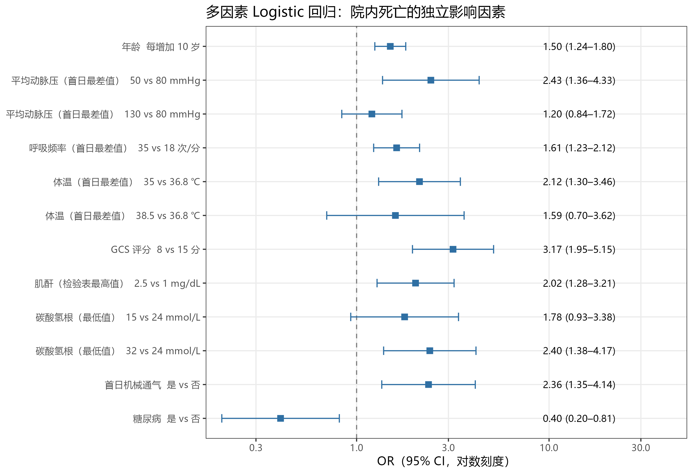
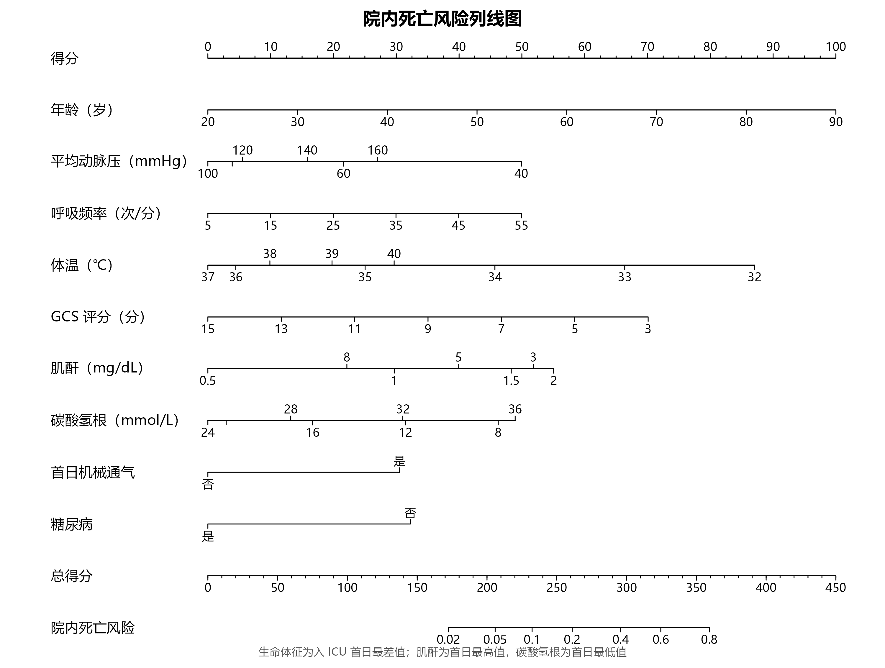
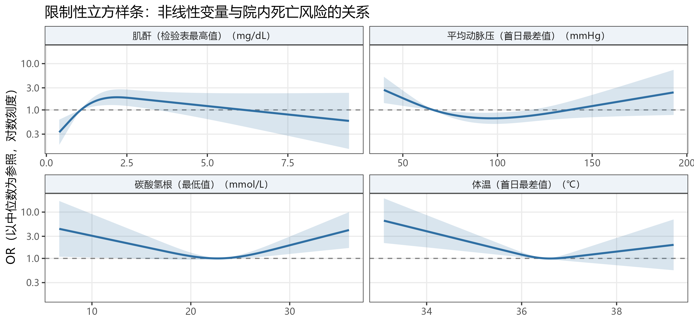
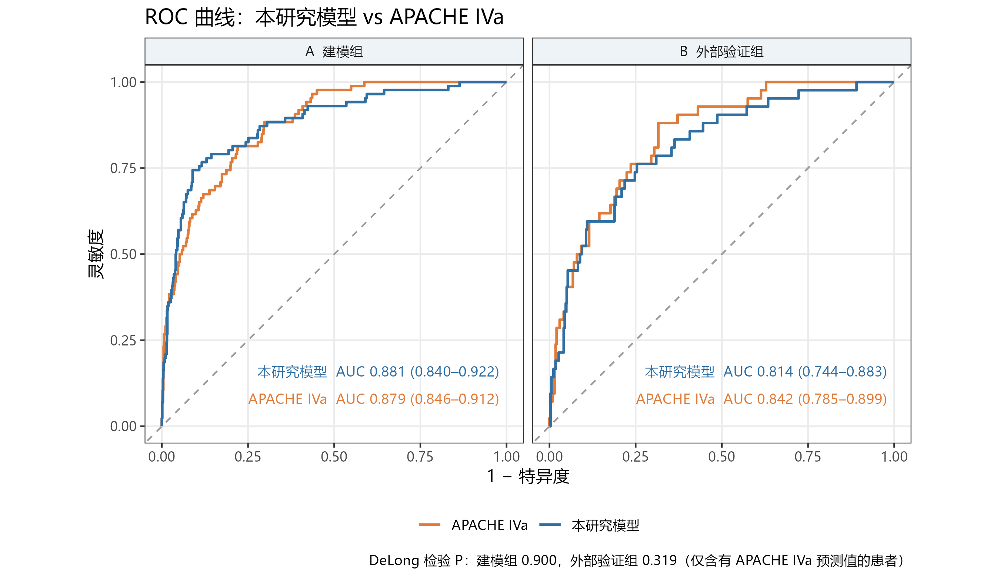
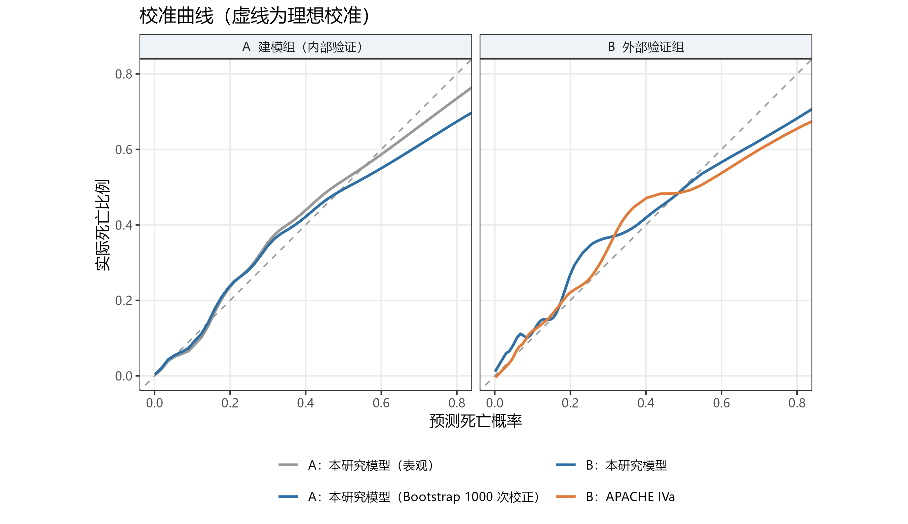
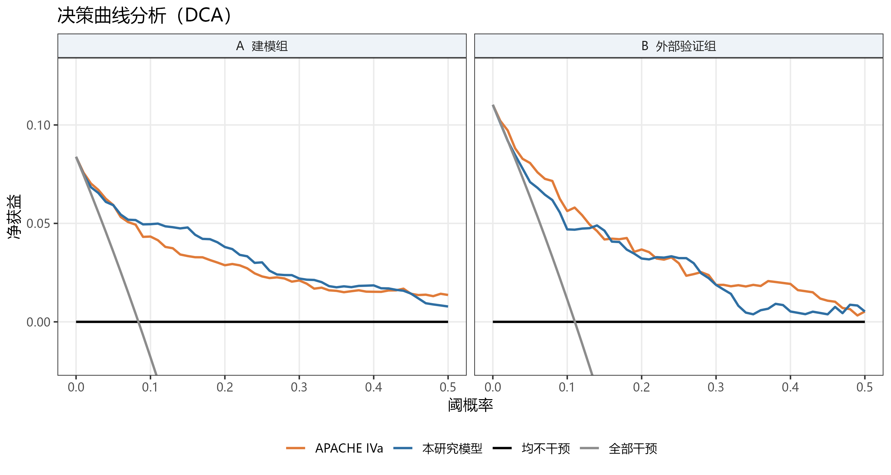
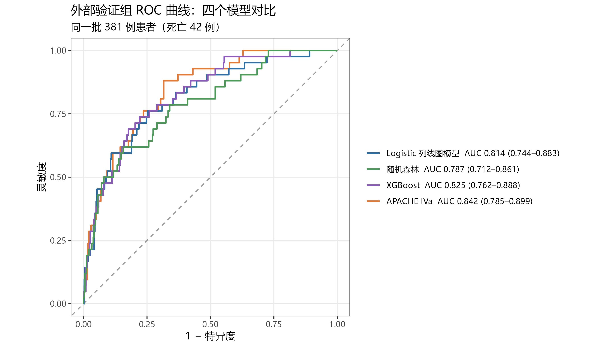
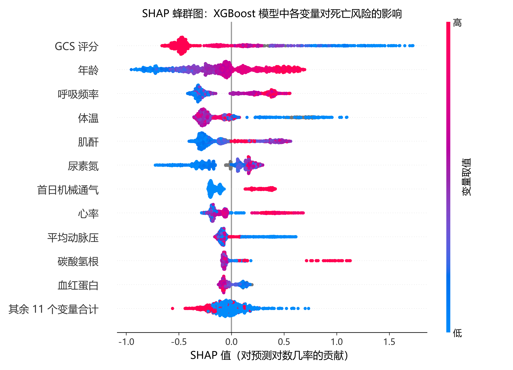
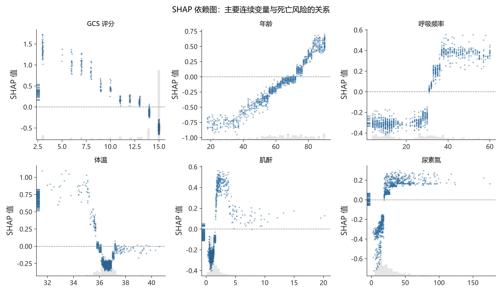

# ICU 患者院内死亡风险预测：基于 eICU 多中心数据的列线图模型构建与外部验证

> 个人数据工程与医学统计项目。完整走一遍医院信息中心的数据工作流：
> **临床问题 → SQL 提数 → 数据质控 → 医学统计 → 预测模型 → 可视化交付**。

**在线演示**：[ICU 死亡风险监护台](https://tuotuonb.github.io/eicu-mortality/)（项目展示版）·
[简洁版风险计算器](https://tuotuonb.github.io/eicu-mortality/dashboard/index.html)

## 1. 研究问题

ICU 患者病情重、变化快，早期识别高死亡风险患者有助于分配医疗资源、和家属沟通预后。
本项目利用入 ICU **首日**即可获得的临床数据，构建院内死亡风险预测模型，
并在**不同地区的医院**中做外部验证，再与临床常用的 APACHE IVa 评分进行对比。

## 2. 数据来源

- **eICU Collaborative Research Database Demo v2.0.1**（PhysioNet，开放获取，Open Database License）
- 美国多中心重症数据库的公开子集：2,520 次 ICU 入住，来自 **186 家医院**
- 数据已去标识化。所有时间以"距入 ICU 时刻的分钟数"存储

## 3. 研究设计

### 3.1 患者筛选流程

```
全部 ICU 入住记录                         2,520 例（院内死亡 212 例）
  │ 保留每位患者首次住院的首次 ICU 入住
  ▼                                       1,841 例（168 例）
  │ 排除年龄 < 18 岁或年龄缺失
  ▼                                       1,834 例（166 例）
  │ 排除 ICU 停留不足 4 小时（参照 APACHE IV）
  ▼                                       1,752 例（153 例）
  │ 排除出院结局缺失
  ▼                                       1,729 例（153 例）
  │ 排除缺少 APACHE 首日生理数据
  ▼
最终纳入                                  1,668 例（151 例，9.1%）
  ├─ 建模组：中西部、南部医院              1,217 例（100 例，8.2%）
  └─ 验证组：西部、东北部医院                451 例（51 例，11.3%）
```

排除标准用的是"ICU 停留不足 4 小时"而不是常见的 24 小时：本数据中 ICU 停留不足 24 小时的有 893 例，
其中包括 71 例死亡，按 24 小时排除会丢失近三分之一的死亡病例，引入严重的选择偏倚。

### 3.2 结局与预测变量

- **结局**：院内死亡
- **候选预测变量（22 个）**：入 ICU 首日即可获得、缺失率 < 30%、有临床意义
  - 人口学：年龄、性别
  - 生命体征（APACHE 首日最差值）：心率、平均动脉压、呼吸频率、体温、GCS 评分
  - 检验指标（从原始检验表用 SQL 提取，时间窗口为入 ICU 前 6 小时 ～ 入 ICU 后 24 小时）：
    尿素氮、肌酐、白细胞、血红蛋白、血小板、碳酸氢根、血钾，以及 APACHE 表的血糖
  - 治疗与入院类型：首日机械通气、择期手术
  - 合并症：糖尿病、免疫抑制、转移性肿瘤、肝硬化、血液系统肿瘤
- 乳酸（缺失 68.5%）和血气指标（缺失 81.5%）不进入模型

### 3.3 地理外部验证

按医院所在地区划分：**中西部、南部医院的患者用于建模，西部、东北部医院的患者用于外部验证**。
验证组的医院在建模时完全没有出现过，可以检验模型在其他医院的泛化能力。

### 3.4 统计分析方法

| 步骤 | 方法 |
|---|---|
| 缺失值 | 多重插补（mice，预测均值匹配，5 次），建模组和验证组分别插补 |
| 单因素分析 | Logistic 回归；连续变量用限制性立方样条（RCS，3 个节点）检验整体关联和非线性 |
| 变量筛选 | 单因素 P < 0.05 的变量进入多因素模型，非线性显著的保留 RCS 形式，再按 AIC 向后逐步回归 |
| 多因素模型 | 5 个插补数据集分别拟合，按 Rubin 规则合并 |
| 内部验证 | Bootstrap 1000 次，**每次重抽样都重做变量筛选**，校正乐观偏倚 |
| 外部验证 | 验证组的区分度（AUC，DeLong 置信区间）、校准度（校准曲线、截距、斜率、Hosmer-Lemeshow 检验）、临床获益（DCA） |
| 与 APACHE IVa 比较 | 在同一批有 APACHE IVa 预测值的患者中，配对 DeLong 检验比较 AUC |

统计分析用 R 4.6（rms、mice、pROC、dcurves）完成。

## 4. 技术路线

```
data/raw (eICU csv.gz)
   │  DuckDB + SQL：队列筛选、首日特征提取、数据清洗（窗口函数、条件聚合）
   ▼
data/processed/analysis_dataset.csv（一行一位患者）
   │  Python：数据质控（缺失率、分布、跨表一致性校验）
   │  R：基线特征表、Logistic 回归、列线图、校准曲线、DCA
   │  Python：机器学习对比与 SHAP 可解释性
   ▼
results/（表格、图表、报告） + dashboard/（风险计算器网页）
```

## 5. 项目结构

```
eicu-mortality/
├── run_all.py              一键运行全流程
├── index.html              GitHub Pages 入口，跳转到项目展示页
├── .github/workflows/      推送到 main 后自动发布网页（GitHub Actions）
├── config/variables.csv    变量字典（中文名、单位、类型），Python 和 R 共用
├── sql/                    提数 SQL（DuckDB 方言）
│   ├── 01_cohort.sql           队列筛选与流程统计
│   ├── 02_apache_features.sql  APACHE 首日变量
│   ├── 03_lab_first24h.sql     原始检验表提取首日检验指标
│   └── 04_analysis_dataset.sql 合并宽表，划分建模组 / 验证组
├── src/                    Python
│   ├── download_data.py        下载数据并校验
│   ├── build_dataset.py        执行 SQL，生成分析数据集
│   ├── data_quality.py         数据质控报告
│   ├── ml_models.py            随机森林、XGBoost、SHAP
│   └── build_dashboard.py      生成风险计算器网页
├── R/                      R：统计分析与建模
│   ├── utils.R                 共用的绘图主题与工具函数
│   ├── 00_setup.R              安装依赖包
│   ├── 01_table1.R             基线特征表
│   ├── 02_model.R              插补、建模、列线图、内部 / 外部验证
│   └── 03_ml_compare.R         四个模型在外部验证组的对比
├── docs/hospital_mapping.md eICU 表与国内医院信息系统的对应关系
├── results/                输出的表格、图表、报告
│   ├── tables/                 Table 1–6（CSV，Excel 可直接打开）
│   ├── figures/                森林图、列线图、RCS、ROC、校准曲线、DCA、SHAP
│   └── model/                  模型系数与样条节点、各模型预测值
└── dashboard/              风险计算器网页（template.html → index.html）
```

## 6. 如何复现

需要 Python 3.12 和 R 4.x。

```bash
python -m venv .venv
.venv/Scripts/python.exe -m pip install -r requirements.txt
Rscript R/00_setup.R
.venv/Scripts/python.exe run_all.py
```

`run_all.py` 会自动下载数据（并做 SHA256 校验），然后依次执行提数、质控和统计分析。

## 7. 主要结果

### 7.1 基线特征

完整表格：[存活 vs 死亡](results/tables/table1_by_outcome.csv)、[建模组 vs 验证组](results/tables/table1_by_split.csv)。

| 指标 | 存活组（n = 1,517） | 死亡组（n = 151） | P |
|---|---|---|---|
| 年龄（岁） | 65.0 [52.0, 76.0] | 76.0 [64.5, 83.0] | < 0.001 |
| GCS 评分 | 15.0 [14.0, 15.0] | 13.0 [7.0, 15.0] | < 0.001 |
| 肌酐（mg/dL） | 1.0 [0.7, 1.4] | 1.6 [0.9, 2.4] | < 0.001 |
| 乳酸最高值（mmol/L） | 1.9 [1.2, 3.1] | 3.8 [1.8, 8.0] | < 0.001 |
| 首日机械通气 | 316 (20.8%) | 81 (53.6%) | < 0.001 |
| 择期手术 | 245 (16.2%) | 10 (6.6%) | 0.003 |
| APACHE IV 评分 | 47.0 [36.0, 62.0] | 78.0 [59.0, 103.0] | < 0.001 |

连续变量为 中位数 [四分位间距]，Mann-Whitney U 检验；分类变量为 n (%)，卡方检验。
建模组与验证组除年龄外基本可比（验证组年龄中位数 69 岁，建模组 65 岁，P = 0.016），验证组院内死亡率略高（11.3% vs 8.2%）。

### 7.2 数据质控发现

完整报告：[results/data_quality_report.md](results/data_quality_report.md)

- **跨表一致性校验通过**：从原始检验表用 SQL 提取的首日最高肌酐，与 APACHE 表记录的首日最差肌酐高度一致
  （1,267 例配对，Spearman ρ = 0.947，差值中位数 0），说明提数的时间窗口和清洗规则正确。
- **乳酸缺失率 68.5%**：这是真实的临床现象，乳酸通常只对疑似休克、脓毒症的患者检测，
  缺失本身带有信息（informative missingness），不能简单当作随机缺失处理。
- **血气指标（pH、PaO2、FiO2）缺失 81.5%**：只有部分患者做了动脉血气，不进入主模型。
- **自己用 SQL 从原始检验表提取，缺失率从 24–29% 降到 5–8%**：APACHE 表只记录用于评分的那一个值，
  原始检验表保留了全部结果。建模时检验指标一律使用 SQL 提取的版本。

  | 指标 | APACHE 表缺失率 | SQL 提取缺失率 |
  |---|---|---|
  | 尿素氮 | 24.1% | 5.5% |
  | 肌酐 | 23.8% | 5.6% |
  | 白细胞 | 29.2% | 7.6% |
  | 红细胞压积 / 血红蛋白 | 26.9% | 7.8% |

- **APACHE 的"最差值"是偏离正常最远的值**：平均动脉压等指标既可能取最低值、也可能取最高值，
  与死亡风险呈 U 型关系。例如平均动脉压按线性项分析 OR = 0.99，看似无关；用 RCS 分析 P < 0.001。
- **体温异常值**：首日最差体温中有 22.2 ℃、23.3 ℃、28.8 ℃ 三个生理上不可能的值，按 30–43 ℃ 的合理范围清洗后视为缺失。
  这 3 个值会改变逐步回归的变量筛选结果，清洗后外部验证 AUC 从 0.788 提高到 0.814。

### 7.3 预测模型

**最终模型包含 9 个变量**（13 个参数，EPV = 7.7）：年龄、平均动脉压、呼吸频率、体温、GCS 评分、肌酐、碳酸氢根、
首日机械通气、糖尿病。其中平均动脉压、体温、肌酐、碳酸氢根以 RCS 形式进入模型。







**模型性能**（完整表格见 [table4_performance.csv](results/tables/table4_performance.csv)）：

| 数据集 | 模型 | 例数（死亡） | AUC (95% CI) | 校准斜率 | Brier |
|---|---|---|---|---|---|
| 建模组 | 本研究模型（表观） | 1,217（100） | 0.883 (0.847–0.919) | 1.03 | 0.055 |
| 建模组 | 本研究模型（Bootstrap 1000 次校正） | 1,217（100） | 0.849 | 0.85 | 0.061 |
| 外部验证组 | 本研究模型 | 451（51） | 0.814 (0.749–0.879) | 0.75 | 0.081 |
| 外部验证组* | 本研究模型 | 381（42） | 0.814 (0.744–0.883) | 0.73 | 0.082 |
| 外部验证组* | APACHE IVa | 381（42） | 0.842 (0.785–0.899) | 0.99 | 0.080 |

\* 仅含有 APACHE IVa 预测值的患者。外部验证组中，本研究模型与 APACHE IVa 的 AUC 差异无统计学意义（配对 DeLong 检验 P = 0.319）；
建模组中两者几乎相同（0.881 vs 0.879，P = 0.900）。







### 7.4 讨论与局限性

- **用 9 个床旁易得的指标，达到了与 APACHE IVa 相近的区分度。** APACHE IVa 需要 100 多个变量，
  其中包括上百类入院诊断，人工录入负担重；本模型的变量都可以从 HIS / LIS 自动提取。
- **外部验证时性能下降**（AUC 从 0.849 降到 0.814，校准斜率 0.75），说明模型存在一定程度的过拟合。
  这与样本量有限有关：建模组只有 100 例死亡事件，EPV 7.7，低于常用的 10。这正是做外部验证的意义所在。
- **糖尿病的 OR 小于 1（0.40）**：部分重症研究也报告过类似现象（常被称为"糖尿病悖论"），
  但也可能来自残余混杂或小样本波动，需要谨慎解读，不应理解为糖尿病有保护作用。
- **肌酐与死亡风险呈倒 U 型**：肌酐约 2 mg/dL 时风险最高，更高时反而下降。可能与长期透析的慢性肾病患者
  基础肌酐很高、但急性病情相对较轻有关。
- **逐步回归在小样本下不稳定**：3 个体温异常值就改变了入选变量。内部验证中每次 Bootstrap 都重做了筛选，
  已经把这种不稳定性计入校正后的指标；后续可尝试惩罚回归（如 LASSO、岭回归）进一步改善。
- **数据代表性**：eICU 数据来自 2014–2015 年的美国医院，直接用于国内医院前需要用本地数据重新验证和校准。

### 7.5 机器学习对比与 SHAP 可解释性

随机森林和 XGBoost 使用全部 22 个候选变量，在建模组用 5 折交叉验证网格搜索调参；
随机森林的缺失值用建模组中位数插补，XGBoost 原生处理缺失值。完整结果见
[table6_model_comparison.csv](results/tables/table6_model_comparison.csv)。

| 模型 | 变量数 | 建模组 AUC | 外部验证组 AUC (95% CI) | 与 Logistic 比较 P |
|---|---|---|---|---|
| **Logistic 列线图模型** | 9 | 0.849（Bootstrap 校正） | 0.814 (0.749–0.879) | — |
| XGBoost | 22 | 0.834（5 折交叉验证） | 0.818 (0.758–0.878) | 0.818 |
| 随机森林 | 22 | 0.830（5 折交叉验证） | 0.798 (0.734–0.862) | 0.510 |



- **机器学习没有显著优于 Logistic 回归。** 在这类变量不多的表格数据上，这和临床预测模型领域的主流结论一致。
  Logistic 模型只用 9 个变量、可以画成列线图、每个系数都能解释，所以最终选它来做风险计算器。
- **SHAP 分析与 Logistic 模型相互印证。** XGBoost 最重要的变量（GCS、年龄、呼吸频率、体温、肌酐、机械通气、平均动脉压、碳酸氢根）
  与 Logistic 模型筛出的变量高度一致；SHAP 依赖图同样显示体温呈 U 型、肌酐在约 2 mg/dL 处风险最高，
  与 RCS 曲线的形状相同。参数模型和树模型两种完全不同的方法得到了一致的结论。





## 8. 网页

两个单文件网页，已通过 GitHub Pages 发布，也可以下载后用浏览器直接打开：

- **[`dashboard/showcase.html`](https://tuotuonb.github.io/eicu-mortality/dashboard/showcase.html)：ICU 死亡风险监护台（项目展示版）**。首屏是床旁监护仪风格的风险计算器，
  动脉压、呼吸波形随输入变化；往下依次展示患者筛选流程与 SQL、缺失率对比、由模型系数实时计算的非线性曲线
  （标出当前患者位置）、四个模型的交互式 ROC 对比和 SHAP 重要性。
- **[`dashboard/index.html`](https://tuotuonb.github.io/eicu-mortality/dashboard/index.html)：简洁版风险计算器**。输入入 ICU 首日的 9 项指标，
  实时显示预测死亡风险、百人图和每个指标的列线图得分。

- 网页里的计算公式（含限制性立方样条）与 R 模型逐位一致：12 个校验样例的最大误差为 2×10⁻¹⁰
- 模型系数和性能数字由 `src/build_dashboard.py` 从分析结果自动写入，模型更新后重新运行即可同步
- 肌酐同时显示国内常用的 µmol/L 单位；输入超出建模数据常见范围时会给出提示

## 9. 进度

- [x] 数据下载与校验
- [x] SQL 队列筛选与首日特征提取
- [x] 数据质控报告（缺失率、跨表一致性校验）
- [x] 基线特征表（Table 1）
- [x] 多重插补、单因素与多因素 Logistic 回归、森林图、RCS 曲线
- [x] 列线图、Bootstrap 内部验证、校准曲线、ROC、DCA
- [x] 地理外部验证，与 APACHE IVa 对比
- [x] 机器学习模型对比（随机森林、XGBoost）与 SHAP 可解释性
- [x] 风险计算器网页

## 10. 医院视角与数据合规

- eICU 各表与国内医院 HIS / LIS / 电子病历的对应关系，以及提数时的共通要点：见 [docs/hospital_mapping.md](docs/hospital_mapping.md)
- 本项目只使用开放获取的去标识化数据，不包含任何可识别个人身份的信息

## 引用

- Pollard T, Badawi O, Raffa J. eICU Collaborative Research Database Demo (version 2.0.1). PhysioNet. 2021. https://doi.org/10.13026/4mxk-na84
- Pollard TJ, Johnson AEW, Raffa JD, Celi LA, Mark RG, Badawi O. The eICU Collaborative Research Database, a freely available multi-center database for critical care research. Scientific Data. 2018.
